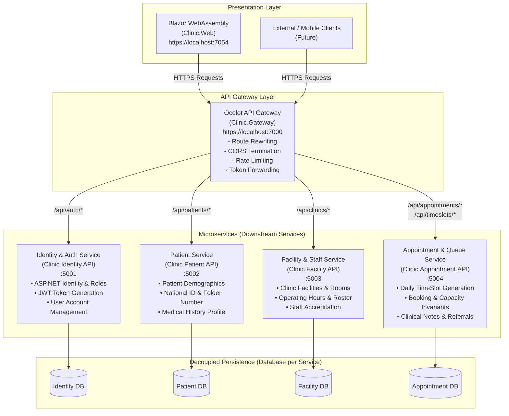
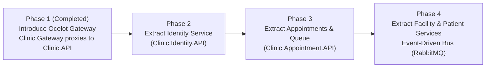

# 🌐 Target Microservices Architecture with Ocelot API Gateway

This document outlines the architectural blueprint, design decisions, and migration roadmap for transitioning the **PHCIS Clinic Booking System** from a modular Clean Architecture monolith to a distributed **Microservices Architecture** using **Ocelot** as the unified API Gateway.

---

## 1. Architectural Overview

In this target architecture, the front-end clients (Blazor WebAssembly `Clinic.Web`, future mobile apps, or external integrations) interface exclusively with the **Ocelot API Gateway**. Downstream services are isolated by domain bounded contexts, each maintaining autonomous data ownership and lifecycle management.



---

## 2. API Gateway Responsibilities (`Clinic.Gateway`)

The **Ocelot API Gateway** runs on `https://localhost:7000` (HTTP `5000`) and serves as the single entry point into the system:

1. **Reverse Proxying & Routing**: Decouples client URLs from internal microservice network topology and port allocations.
2. **Centralized CORS Termination**: Eliminates cross-origin browser issues between the Blazor WebAssembly client and distributed microservices.
3. **Authentication Header Forwarding**: Inspects and forwards `Authorization: Bearer <jwt-token>` downstream to services for distributed role authorization.
4. **Rate Limiting & DDoS Protection**: Throttles abuse before traffic reaches downstream domain services.
5. **SSL Offloading / Developer Certificate Handling**: Configured with `DangerousAcceptAnyServerCertificateValidator` in development to ensure seamless local TLS communication across containerized and host-run services.

### Gateway Route Configuration (`ocelot.json`)

```json
{
  "Routes": [
    {
      "DownstreamPathTemplate": "/api/auth/{everything}",
      "DownstreamScheme": "https",
      "DownstreamHostAndPorts": [
        { "Host": "localhost", "Port": 5001 }
      ],
      "UpstreamPathTemplate": "/api/auth/{everything}",
      "UpstreamHttpMethod": [ "GET", "POST", "PUT", "DELETE", "OPTIONS" ],
      "DangerousAcceptAnyServerCertificateValidator": true
    },
    {
      "DownstreamPathTemplate": "/api/patients/{everything}",
      "DownstreamScheme": "https",
      "DownstreamHostAndPorts": [
        { "Host": "localhost", "Port": 5002 }
      ],
      "UpstreamPathTemplate": "/api/patients/{everything}",
      "UpstreamHttpMethod": [ "GET", "POST", "PUT", "DELETE", "OPTIONS" ],
      "DangerousAcceptAnyServerCertificateValidator": true
    },
    {
      "DownstreamPathTemplate": "/api/clinics/{everything}",
      "DownstreamScheme": "https",
      "DownstreamHostAndPorts": [
        { "Host": "localhost", "Port": 5003 }
      ],
      "UpstreamPathTemplate": "/api/clinics/{everything}",
      "UpstreamHttpMethod": [ "GET", "POST", "PUT", "DELETE", "OPTIONS" ],
      "DangerousAcceptAnyServerCertificateValidator": true
    },
    {
      "DownstreamPathTemplate": "/api/appointments/{everything}",
      "DownstreamScheme": "https",
      "DownstreamHostAndPorts": [
        { "Host": "localhost", "Port": 5004 }
      ],
      "UpstreamPathTemplate": "/api/appointments/{everything}",
      "UpstreamHttpMethod": [ "GET", "POST", "PUT", "DELETE", "OPTIONS" ],
      "DangerousAcceptAnyServerCertificateValidator": true
    }
  ],
  "GlobalConfiguration": {
    "BaseUrl": "https://localhost:7000"
  }
}
```

---

## 3. Microservices Domain Decomposition

| Microservice | Bounded Context | Owned Entities & Value Objects | Key Endpoints |
| :--- | :--- | :--- | :--- |
| **`Clinic.Identity.API`** | Identity, Authentication & RBAC | `ApplicationUser`, `IdentityRole`, Refresh Tokens | `POST /api/auth/login`<br>`POST /api/auth/register-patient`<br>`POST /api/auth/register-staff` |
| **`Clinic.Patient.API`** | Patient Master Index (PMI) | `Patient`, `EmergencyContact`, `MedicalHistory` | `GET /api/patients/{id}`<br>`GET /api/patients/by-national-id`<br>`PUT /api/patients/{id}` |
| **`Clinic.Facility.API`** | Clinic Operations & Facilities | `ClinicFacility`, `OperatingHours`, `ConsultationRoom`, `ClinicStaff` | `GET /api/clinics`<br>`GET /api/clinics/{id}`<br>`GET /api/clinicstaff` |
| **`Clinic.Appointment.API`** | Scheduling, Queue & Clinical Visits | `TimeSlot`, `Appointment`, `ConsultationNotes` | `GET /api/timeslots`<br>`POST /api/appointments`<br>`PUT /api/appointments/{id}/process`<br>`PUT /api/appointments/{id}/notes` |

---

## 4. Data Storage & Decoupling Strategy

### Database-per-Service Principle
In a clean microservice architecture, no microservice directly queries the tables of another service. Foreign key constraints across service boundaries are eliminated:

- **Entity Reference by UUID**:
  - `Appointment` holds `Guid PatientId`, `Guid ClinicFacilityId`, and `Guid? AssignedStaffId`, but no direct EF Core navigational properties (`Patient`, `ClinicFacility`).
- **Read-Model Denormalization**:
  - Frequently needed display fields (e.g., `PatientName`, `ClinicName`, `StaffName`) are stamped onto appointment records upon creation or populated via event notifications.
- **Asynchronous Event Synchronization**:
  - When a patient updates contact information in `Patient.API`, a `PatientContactUpdatedEvent` can be published via MassTransit/RabbitMQ so dependent read-stores remain consistent without distributed database locks.

---

## 5. Phased Migration Strategy (Strangler Fig Pattern)

The transition follows the **Strangler Fig Pattern** to guarantee zero downtime and continuous feature delivery:



- **Phase 1: Gateway Layer (Completed)**:
  - Added `Clinic.Gateway` (.NET 9 + Ocelot 25.0.2).
  - Repointed `Clinic.Web` base URL to `https://localhost:7000/`.
  - All routes currently proxy downstream to `Clinic.API` (`:7193`).
- **Phase 2: Identity Extraction**:
  - Isolate ASP.NET Core Identity tables and authentication endpoints into `Clinic.Identity.API`.
  - Update `ocelot.json` to route `/api/auth/*` to port `5001`.
- **Phase 3: Scheduling & Queue Extraction**:
  - Migrate appointment commands/queries and EF migrations into `Clinic.Appointment.API`.
  - Update `ocelot.json` to route `/api/appointments/*` and `/api/timeslots/*` to port `5004`.
- **Phase 4: Facility & Patient Separation + Messaging**:
  - Separate `Clinic.Facility.API` and `Clinic.Patient.API`.
  - Integrate MassTransit with RabbitMQ for event-driven updates.

---

## 6. How to Run Locally with Ocelot

### Visual Studio (Multiple Startup Projects)
1. Open [`Clinic.slnx`](file:///C:/Customer-Dev/Clinic/Clinic.slnx).
2. Right-click the Solution node &rarr; **Properties** &rarr; **Common Properties** &rarr; **Startup Project**.
3. Select **Multiple startup projects**:
   - `Clinic.Gateway`: **Start** (`https://localhost:7000`)
   - `Clinic.API`: **Start** (`https://localhost:7193`)
   - `Clinic.Web`: **Start** (`https://localhost:7054` / `7147`)
4. Press **F5** to start all services simultaneously.

### .NET CLI
Run each project in a dedicated terminal window:
```powershell
# Terminal 1: Backend API
dotnet run --project src/Clinic.API/Clinic.API.csproj

# Terminal 2: Ocelot API Gateway
dotnet run --project src/Clinic.Gateway/Clinic.Gateway.csproj

# Terminal 3: Blazor WebAssembly Frontend
dotnet run --project src/Clinic.Web/Clinic.Web.csproj
```
